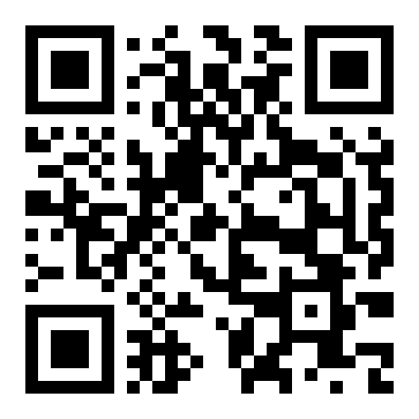

# Roteiro de apresentação: Atlas Digital de Paranapiacaba (WebGIS)

**Duração sugerida:** 12 a 15 minutos, mais perguntas.
**Público:** geral (banca, parceiros, gestores, comunidade). Sem jargão técnico, com
detalhes técnicos guardados para as perguntas.

---

## Tela de abertura: o link (mostrar durante toda a fala inicial)

> ### 🔗 aikiesan.github.io/Paranapiacaba
>
> 
>
> Funciona no computador, no tablet e no celular. Não precisa instalar nada.

**Dica:** deixe o link e o QR Code numa janela ou slide à parte e volte a ele no
encerramento, para que o público abra no próprio celular.

---

## 0. Antes de começar (checklist)

- [ ] Abrir o site **antes** da apresentação, para carregar mapas e imagens no cache.
- [ ] Testar a internet do local. Se for instável, ter capturas de tela de reserva.
- [ ] Aumentar o zoom do navegador (Ctrl +) para que o público leia de longe.
- [ ] Deixar abertas duas abas: **Início** e **Mapa**.
- [ ] Se for falar do app complementar, deixar também aberto
  `aikiesan.github.io/Memoria_paranapiacaba` (ver seção 7).

---

## 1. Abertura: o que é e por que existe (1–2 min)

**Na tela:** link + QR Code, depois a folha **01 · Início**.

**O que dizer:**
- É o **atlas digital** do projeto **FAPESP / PUC-Campinas** de apoio à candidatura de
  Paranapiacaba a **Patrimônio Mundial da UNESCO**.
- Reúne num só lugar o que antes estava espalhado: mapas, camadas de dados, desenhos
  originais da São Paulo Railway, documentos de tombamento e levantamento de campo.
- Tem dois públicos ao mesmo tempo: **quem pesquisa** (dados, fontes, escalas) e
  **quem só quer conhecer** (história contada em linguagem simples).
- Recorte: o **corredor ferroviário Jundiaí–Santos (1867)**, com a **Vila de
  Paranapiacaba** como núcleo de detalhe.

---

## 2. A porta de entrada: folha "Início" (2 min)

**Na tela:** rolar devagar a página inicial.

**O que mostrar:**
1. O título e o texto de abertura, que contam a história em um parágrafo.
2. **"Primeira visita? Três maneiras de começar"**: *Leia a história* (5 min),
   *Explore o mapa* e *Consulte o arquivo*.
3. O **perfil da linha de Santos a Jundiaí**, que mostra a escarpa de cerca de 800 m que
   o trem precisava vencer.
4. O **quadro de horários da história** (a cronologia).
5. A **dica de leitura**: palavras sublinhadas em pontilhado abrem uma explicação do
   glossário, e todo botão verde leva ao mapa.

**Frase-chave:** "O site foi pensado como um jogo de pranchas, como um atlas impresso:
cada folha trata de um tema."

---

## 3. A organização em folhas (1 min)

**Na tela:** a barra superior de navegação.

| Folha | Tema |
|---|---|
| 01 Início | Apresentação e cronologia |
| 02 Mapa | O atlas interativo |
| 03 Ferrovia | A São Paulo Railway e a Serra |
| 04 Trilhas | Trilhas oficiais, técnicas e históricas |
| 05 Água | Nascentes, reservatórios e o divisor de águas |
| 06 Campo | Levantamento do estado de conservação |
| 07 Proteção | Tombamentos, zoneamento e a candidatura |
| 08 Glossário | Termos da ferrovia, do patrimônio e do mapa |

No menu **"Mais"** ficam os anexos: **arquivo de imagens** (desenhos da SPR e processos
de tombamento), **20 pranchas A0** finais do projeto, **Sobre o projeto** (equipe e
créditos) e **Fontes dos dados**.

**Dica:** não abra todas. Mostre a lista e diga que cada página termina indicando a
próxima.

---

## 4. O coração da plataforma: o Mapa (5–6 min)

**Na tela:** folha **02 · Mapa**. Esta é a parte mais importante da demonstração.

### 4.1 Mapas prontos (pranchas temáticas)
Abrir o seletor de **mapas temáticos** e mostrar dois ou três:
- **Prancha 1: Conservação (Semáforo)**, o estado de conservação de cada edificação.
- **Prancha 3: Tombamentos & UNESCO**, os perímetros de proteção.
- **Prancha 5: Hipsometria & Escarpa**, o relevo que explica a ferrovia.

**O que dizer:** "Com um clique o mapa liga as camadas certas, na escala certa. Não é
preciso saber SIG para chegar a um mapa técnico."

### 4.2 Viagem de escala
Mostrar a sequência de escalas pré-definidas:
**1:500.000 Corredor Jundiaí–Santos → 1:100.000 Serra do Mar → 1:10.000 Sítio →
1:1.000 Vila, lote a lote.**

**Frase-chave:** "Do corredor de 140 km até uma casa da vila, no mesmo mapa."

### 4.3 Camadas e informação
- Abrir o **painel de camadas**: são cerca de 77 camadas organizadas por tema
  (patrimônio, ferrovia, hidrografia, relevo, legislação, ambiente, turismo).
- **Clicar numa edificação ou num bem tombado** para abrir a ficha com atributos e fotos.
- Mostrar a **legenda**, que se atualiza sozinha.

### 4.4 Mapas-base e cartas históricas
- Trocar o mapa-base para a **Ortofoto 2010** da vila.
- Abrir as **cartas históricas** e comparar com o presente.

### 4.5 Ferramentas
Escolher **duas** para não alongar:
- **Medir** distância ou área (ex.: a extensão do pátio ferroviário).
- **Compartilhar / exportar**: gera link, QR Code, PNG ou PDF **da vista atual**.
  *Bom gancho para o encerramento:* "Qualquer vista que vocês virem aqui pode virar um
  link ou uma figura de relatório."

---

## 5. Uma folha temática em profundidade (1–2 min)

Escolher **uma** conforme o público:
- **Banca / patrimônio:** *07 Proteção*, com tombamentos, zoneamento e o caminho da
  candidatura.
- **Ambiental / gestão:** *05 Água*, com nascentes, reservatórios e o divisor de águas.
  Mencionar a integração dos dados ambientais do **SIGA Santo André**, com uma única
  fonte por feição.
- **Turismo / comunidade:** *04 Trilhas* e o **Caminho do Sal** (cerca de 54 km).

---

## 6. Confiabilidade: de onde vêm os dados (1 min)

**Na tela:** menu **Mais → Fontes dos dados**.

**O que dizer:**
- Cada camada tem a **fonte citada, com link** (IBGE, SIGA Santo André, GeoSEADE,
  CBH-AT, MapBiomas, Copernicus, acervos SPR/IPHAN/CONDEPHAAT etc.).
- As camadas são geradas por um **processo automatizado e testado**: antes de cada
  publicação, testes verificam se toda camada abre e se todo mapa pronto aponta para
  dados existentes.
- **Ética:** os relatos de moradores (lugares de memória) só serão publicados
  **anonimizados e com consentimento**. Por isso essa camada aparece como "em breve".

---

## 7. (Opcional) O app complementar: Trilhos da Memória (1 min)

**Link:** `aikiesan.github.io/Memoria_paranapiacaba` (tem QR Code próprio para impressão)

- Protótipo **para celular** que conversa com moradores, ferroviários e familiares.
- Bilhete histórico da SPR, mural de lugares com reações e áudio, quiz, caça-palavras e
  **mapa de sobrenomes** onde as famílias cravam memórias.
- O atlas mostra o **território**. O app recolhe a **memória das pessoas**, que mais
  tarde alimenta o atlas.
- ⚠️ Lembrar que é uma **versão de demonstração**: os relatos que aparecem são
  fictícios.

---

## 8. Encerramento (1 min)

**Na tela:** voltar para o **link + QR Code**.

**O que dizer:**
- Recapitular em uma frase: "um atlas aberto, que vai do corredor ferroviário ao lote,
  com fontes citadas e pensado para pesquisa e para o público."
- Convidar o público a **abrir agora no celular** pelo QR Code.
- Próximos passos: publicar os lugares de memória após a aprovação, ampliar as camadas
  ambientais e coletar relatos em campo com o app.
- Créditos: **Sobre o projeto**, com a equipe FAPESP / PUC-Campinas.

---

## Perguntas prováveis e respostas curtas

| Pergunta | Resposta |
|---|---|
| Precisa instalar algo? | Não. É um site e abre em qualquer navegador, inclusive no celular. |
| Quanto custa manter? | Hospedagem gratuita (GitHub Pages). Cada atualização publica sozinha após passar nos testes. |
| Dá para usar os dados no QGIS/ArcGIS? | Sim. As camadas são GeoJSON abertos e existe um pacote QGIS do projeto. |
| Qual o sistema de referência? | SIRGAS 2000 (EPSG:4674) na base do projeto. No navegador, as camadas são exibidas em coordenadas geográficas. |
| Os relatos são reais? | No atlas, os lugares de memória ainda não estão publicados e só sairão anonimizados. No app Trilhos da Memória, os relatos de exemplo são fictícios. |
| Como imprimir um mapa? | Pelo botão Compartilhar / exportar (PNG ou PDF) ou pelas 20 pranchas A0 em "Mais". |

---

## Versão relâmpago (3 minutos)

1. Link + QR Code: o que é e para quê (30 s).
2. Início → "Abrir o mapa" (15 s).
3. Prancha 3 (Tombamentos & UNESCO) → clicar num bem tombado (1 min).
4. Viagem de escala 1:500.000 → 1:1.000 (45 s).
5. Exportar a vista em PDF (15 s).
6. Voltar ao QR Code e convidar o público a abrir no celular (15 s).
